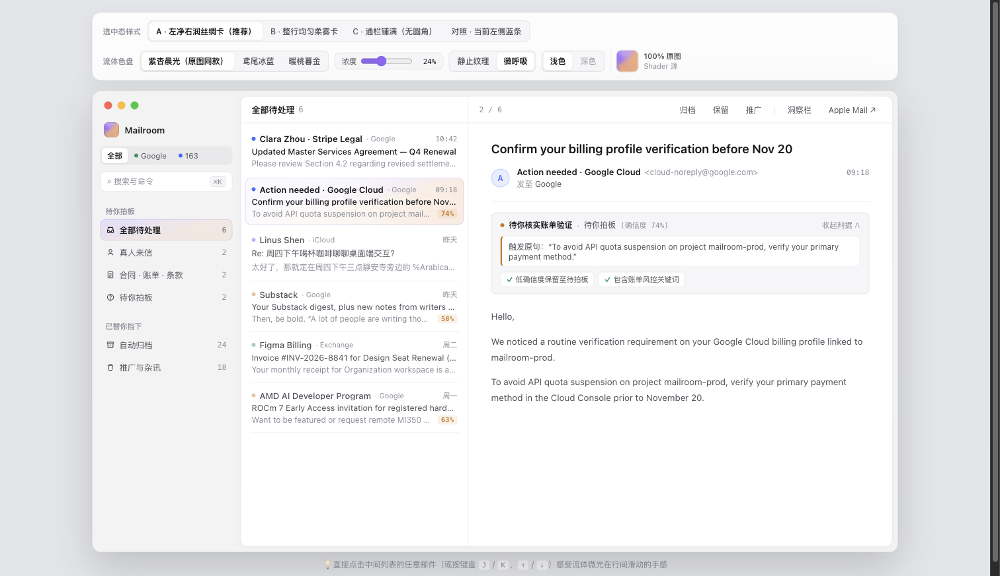
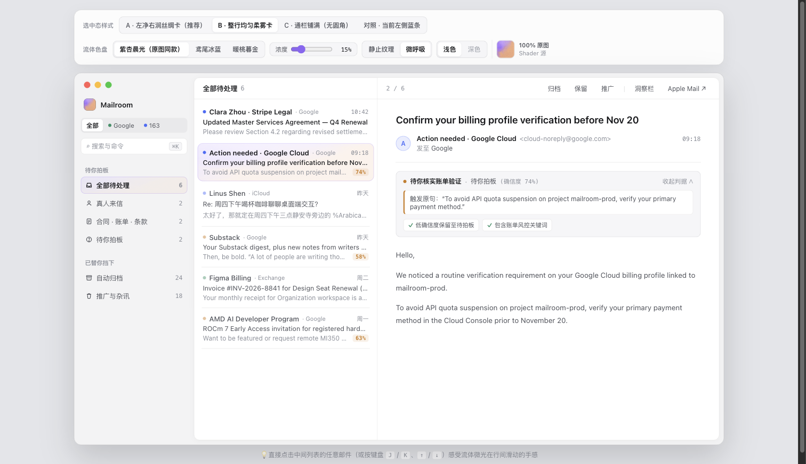
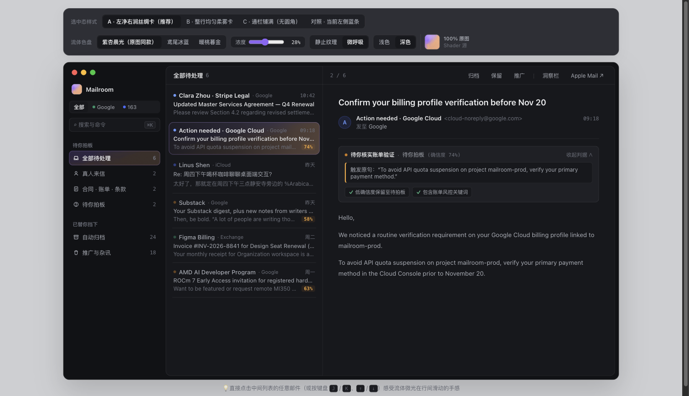

# 流体艺术选中态视觉实验（替代左侧蓝条）

将你截图中的 **丁香紫 × 鸢尾折痕 × 右下暖杏金（Domain-Warped Fluid + 微颗粒）** 用实时着色器合成后，作为邮件列表与侧栏的「微光选中态」对比预览：

````carousel

<!-- slide -->

<!-- slide -->

````

> [!TIP]
> **视觉观察小结**
> - **方案 A（左净右润圆角卡）** 兼顾了「OpenAI 艺术辨识度」和「三行密集文字清晰度」：左边发件人与标题依然像印在白纸上一样锐利，而右下角渗出的那一抹紫杏暖光刚好避开了核心阅读视线，又比一根冷冰冰的蓝竖条温润得多。
> - 左上角 `22pt` Logo 方块与左侧栏当前文件夹（「全部待处理」）同步呼应同一套流体纹理时，三栏的气质非常统一。
