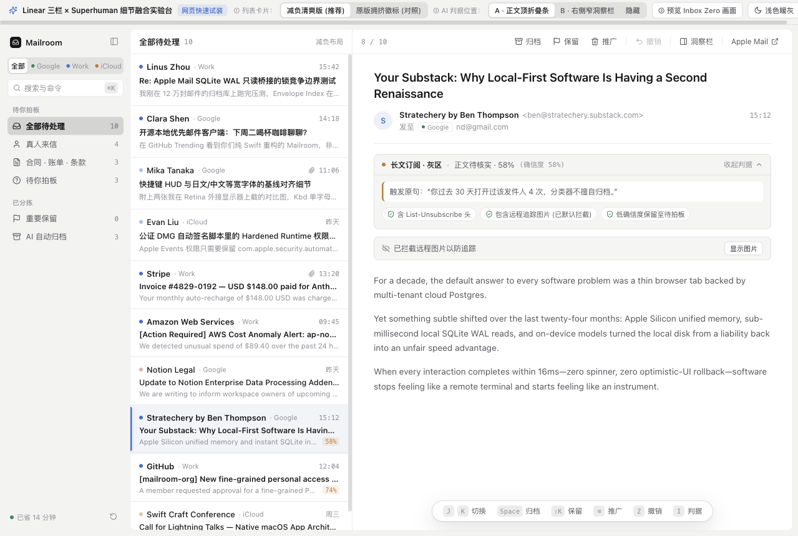
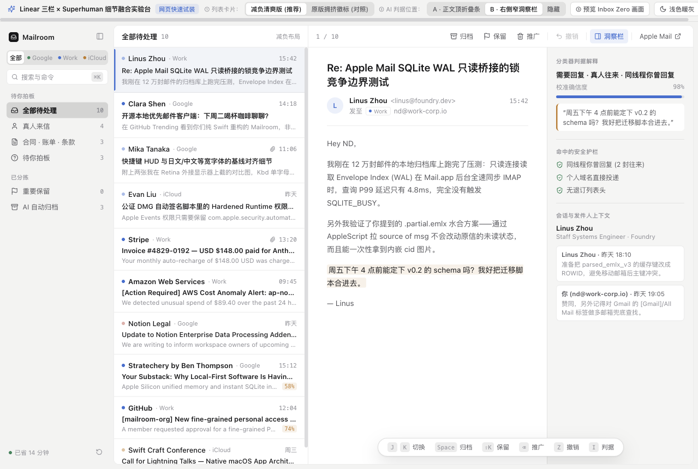
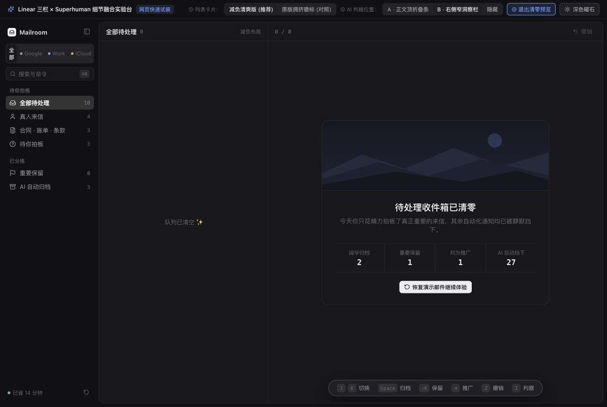

# Linear 三栏 × Superhuman 细节融合实验台

本记录保留早期 Linear × Superhuman 融合实验的设计说明与截图。当前可运行的仓库内原型见 [Fluid Selection 实验台](fluid-selection-lab.html)；早期 React 实验源码未纳入当前仓库。

````carousel

<!-- slide -->

<!-- slide -->

````

> [!TIP]
> 页面最上方专门做了一排 **实验台实时开关**，你可以在同一封邮件上秒切对比改前/改后，无需脑补。

## 本次网页实验台可试玩的 3 组开关

1. **① 列表卡片：`减负清爽版` vs `原版拥挤徽标`**
   - 拿掉了原本把邮件标题挤掉近一半宽度的 `● 正文待核实 58%` 虚线大胶囊与边框账号标，把第 2 行**整行宽度完整还给邮件主题**；
   - 灰区确信度（如 `58%` / `74%`）改为右下角极克制的等宽琥珀微标；
   - 选中态从生硬黑边升级为 **Superhuman 柔和钴蓝光条 + 极淡底色晕染**，鼠标悬停行尾自动浮现 `归档 / 保留 / 推广` 快捷微按钮。
2. **② AI 判据位置：`A · 正文顶折叠条` vs `B · 右侧窄洞察栏`**
   - **A · 正文顶折叠条**：保持最纯粹的三栏结构，不增加第四列；在发件人下方用一条建筑感灰卡展示分类结论、触发原句与命中的安全护栏胶囊（按 `I` 可随时收起成单行）。
   - **B · 右侧窄洞察栏**：类似 Superhuman / Linear Issue 属性栏（右上角点「洞察栏」呼出），独立展示确信度进度条、原文引证框、安全护栏与同线程历史往来记录。
3. **③ 清零画面：`预览 Inbox Zero 画面`（及 `D` 键深浅色切换）**
   - 在克制的统计表格上方加入低饱和几何层叠山脊画卷，兼顾 Linear 的冷静秩序感与清零收工的仪式感。
