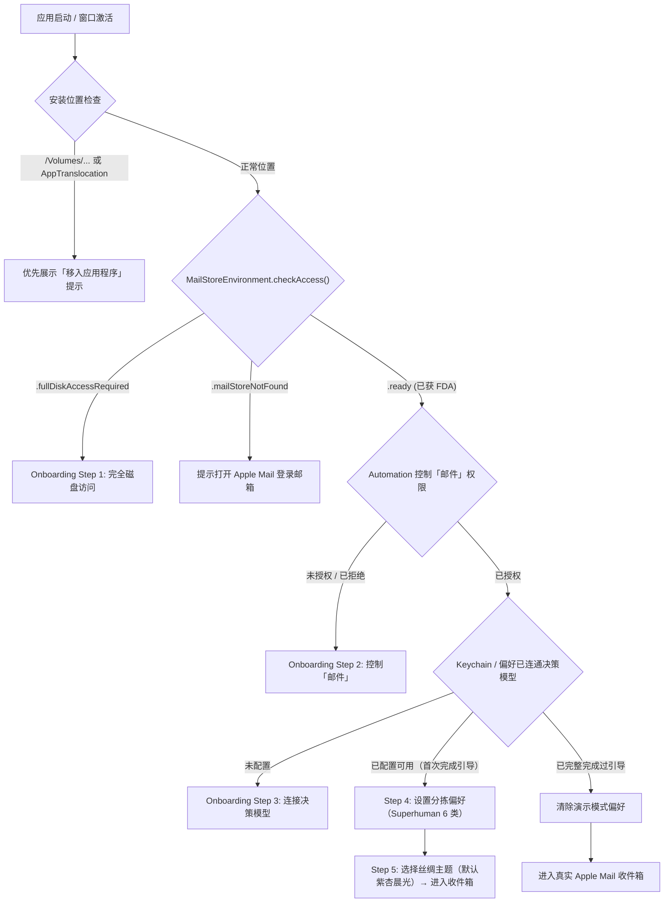

# Sift — Onboarding 引导与门禁设计蓝图

围绕 [Issue #3](https://github.com/DengNaichen/sift/issues/3)、前置 AI 决策模型配置及 Superhuman 分类偏好需求，重做首次启动连接体验：消除正式版初次打开时静默落入演示数据的困惑，收敛为「完全磁盘访问 → 控制『邮件』→ 连接决策模型 → 设置分拣偏好 → 选择视觉主题」五步流畅引导。

---

## 1. 启动分流状态机

---

## 2. 引导界面核心设计决策

1. **严格门禁：前置三项必过，不设跳过入口**
   - 未完成本机 Mail 读写权限（Step 1 & 2）与决策模型连接（Step 3）前，不提供「先浏览演示收件箱」跳过入口，避免演示数据与真机数据混淆，也保证首次进入收件箱即运行完整 System 1 分拣流水线。
   - 复用 [InboxZeroView.swift](../../Sources/MailroomFeatures/Features/ReadingPane/InboxZeroView.swift) 的卡片质感（`p.paper`、`14pt` 圆角、`1px p.lineStrong`、`540pt` 限宽居中）与 [FluidSilkLogoIcon](../../Sources/MailroomFeatures/DesignSystem/DeckTheme.swift) 品牌微标。
   - 处于引导舞台时通过 [KeyRouter.swift](../../Sources/MailroomFeatures/Commands/KeyRouter.swift) 屏蔽 `Space` / `Backspace` / `J` / `K` / `1`–`3` 等单键分拣热键，仅保留全局 `⌘,`、`⌘K` 与浅深外观切换。

2. **Step 1：降低「完全磁盘访问权限」添加摩擦**
   - 提供可拖拽的 **`Sift.app` 图标芯片**（原生 `NSItemProvider` 文件 URL 拖拽），配合「打开系统设置」与「在 Finder 中显示」。
   - 区分 `EPERM`（TCC 拦截 → `.fullDiskAccessRequired`）与 `ENOENT`（未配置 Apple Mail → `.mailStoreNotFound`），防止已开权限但未登录邮箱的用户陷入死循环。
   - 若用户点击过「打开系统设置」返回后权限尚未对当前进程刷新，显示「重启 Sift 以应用权限」兜底按钮。

3. **Step 2：真实检测并触发「自动化控制『邮件』」**
   - 在后台线程调用 `AEDeterminePermissionToAutomateTarget` 检测 `com.apple.mail`；调用前必要时先通过 `AppleMailScriptRunner.ensureMailRunningSilently()` 静默唤醒 `Mail.app`，避免返回 `-600 (procNotFound)` 误判。
   - 与设置页 [AccountsSettingsTab.swift](../../Sources/MailroomFeatures/Features/Settings/AccountsSettingsTab.swift) 共用同一份真实自动化权限状态，移除静态假绿点与模拟延迟。

4. **Step 3：连接 System 1 决策模型**
   - 支持选择 `Gemini`（如 `gemini-decision-1`）、`OpenAI`（如 `gpt-4o-mini`）、`Claude`（如 `claude-haiku-4-5`）或 `Jev / 自定义` 兼容端点，配置 `Model`、`Endpoint` 与 `API Key`。
   - 与设置页 [AIClassifierSettingsTab.swift](../../Sources/MailroomFeatures/Features/Settings/AIClassifierSettingsTab.swift) / [SettingsFormState.swift](../../Sources/MailroomFeatures/Features/Settings/SettingsFormState.swift) 共用同一份模型配置；API Key 必须存放在 **macOS Keychain**，禁止明文落入 `UserDefaults`。
   - 通过「测试连接」实测端点与密钥连通性；全部通过后解锁后续偏好配置。

5. **Step 4：设置分拣偏好（对齐 Superhuman 7 类 + 安全护栏）**
   - 模型层仅上报正交客观信号，动作由本地 `preferences` 决定（对应 `evals/email_rules.py` 与 `evals/email_classification_policy.json` 的 `ALLOWED_PREFERENCES` 契约），调整规则无需修改 Prompt。
   - 引导内提供 3 组快捷预设（**平衡默认** / **零自动删信** / **求职优先**）与 6 类可调矩阵：
     - 禁删保护项（仅 `待处理` / `归档`）：`security`（安全通知，默认待处理）、`fyi`（留档记录，默认归档）。
     - 三选一可调项（`待处理` / `归档` / `废纸篓`）：`news`（订阅资讯，默认归档）、`pitch`（推销荐岗，默认废纸篓）、`social`（社交社区，默认废纸篓）、`marketing`（商业促销，默认废纸篓）。
   - `respond`（待回复/事务故障/面试等）、加星邮件、本人参与对话及受保护工作/财务/安全线程由本地护栏锁死，不在引导页提供删除开关；VIP 白名单与屏蔽列表保留在 [TriageSettingsTab.swift](../../Sources/MailroomFeatures/Features/Settings/TriageSettingsTab.swift) 维护。

6. **Step 5：选择视觉主题（丝绸三配色，非阻塞收尾）**
   - 复用 [fluid-selection-lab.html](../fluid-selection/fluid-selection-lab.html) 定义的三组丝绸高光色板：**紫杏晨光**（默认）、**鸢尾冰蓝**、**暖桃暮金**，每张预览卡同时适配浅色空气晕染与深色丝绒晕染，切换后实时同步窗口内的 Sift 品牌微标。
   - Step 5 默认选中「紫杏晨光」，到达该步时底栏「进入收件箱」已处于可用状态，不构成额外卡点。（注：正式落地时需将三套色板扩展进 [DeckTheme.swift](../../Sources/MailroomFeatures/DesignSystem/DeckTheme.swift) 与 [PreferencesStore.swift](../../Sources/MailroomFeatures/Stores/PreferencesStore.swift)。）

7. **后台自动感知与演示模式（设置页按需切换）**
   - 停留 Step 1 / Step 2 期间，结合 `NSApplication.didBecomeActiveNotification` 与 `1.2s` 轻量轮询自动检测系统权限变化并推进到下一步。
   - 演示数据仍可通过 `设置 → 邮箱与连接` 手动切换使用；切入演示数据后在侧边栏底部状态卡与阅读区顶栏保留醒目的 `演示模式 · 连接 Apple Mail` 入口。
