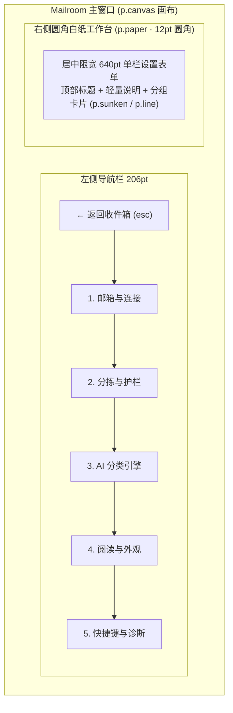

# Mailroom Deck — Settings 页面设计蓝图

延续 Mailroom Deck 的 **Linear 式建筑感中性灰阶 + 内嵌白纸工作台** 语言，Settings 不做脱离上下文的独立弹窗，而是在当前主窗口内完成「分拣台 ↔ 设置台」的原地切换，每一项配置都围绕**「建立自动分拣信任感」**与**「打磨日常键盘流手感」**展开。

---

## 1. 空间承载与进出动效（Linear 式内嵌工作台）

触发 `⌘,`、点击左侧边栏左下角齿轮（[SidebarView.swift](file:///Users/nd/Developer/mailroom-deck/Sources/MailroomApp/Views/SidebarView.swift#L152-L192)），或在 `⌘K` 命令面板搜索任意设置项时，主窗口保持外框与 6pt 内嵌白纸结构不变（[MailroomApp.swift](file:///Users/nd/Developer/mailroom-deck/Sources/MailroomApp/MailroomApp.swift#L61-L78)）：

### 键盘流与交互细节
- **原地进出**：`⌘,` 随时在「收件箱 ↔ 设置（记住上次停留的分组）」之间切换；在设置页内未聚焦文本输入框时，按 `Esc` 立即回到刚才那封邮件的焦点位置。
- **侧栏收起兼容**：即便用户在分拣时按 `[` 收起了左侧边栏，进入 Settings 时临时展开左侧 `206pt` 设置导航，退出 Settings 后自动恢复原先的侧栏收起/展开状态。
- **`⌘K` 深链直达**：把高频设置注册进 [DeckViewModel.swift](file:///Users/nd/Developer/mailroom-deck/Sources/MailroomApp/ViewModel/DeckViewModel.swift#L444-L595) 的 `paletteCommands`（如搜 `API Key`、`主题`、`缓存`、`推广`、`权限` 直接打开 Settings 并滚到对应分组）。
- **即时生效（Zero Save Buttons）**：除 API Key 编辑与危险重置外，所有开关、滑块、策略切换均实时持久化并驱动工作台状态刷新，不设「保存 / 取消」底栏。

> [!TIP]
> 把原先「AI 与分拣」拆为 **「分拣与护栏」**（管*行为结果*）与 **「AI 分类引擎」**（管*模型来源、Key 与阈值*）两个独立分组后，每一页都能控制在 **1～1.5 屏内扫完**，避免长滚屏带来的压迫感。

---

## 2. 五大分组与控件细目

### ① 邮箱与连接（Accounts & Apple Mail）
解决「连上了吗？哪些邮箱归它管？按归档后邮件去了哪？」三个核心信任问题。

| 区块 | 控件与视觉表达 | 对接底层能力 |
| --- | --- | --- |
| **双权限健康状态卡** | 顶部 `p.sunken` 圆角卡，分两行展示： 1. **完全磁盘访问（只读同步索引）**：绿点 `已就绪 (~/Library/Mail/V10)` 或琥珀点 + `打开系统设置` / `重新检测` 2. **控制「邮件」自动化（写回归档与删除）**：显示授权状态 + `测试连接` 轻量按钮（提前触发系统授权，避免首次按 `Space` 才报错） | [AppleMailAdapter.swift](file:///Users/nd/Developer/mailroom-deck/Sources/MailroomCore/MailBridge/AppleMailAdapter.swift#L35-L55) + `AppleMailScriptRunner` |
| **已识别邮箱账户** | 列表展示每个系统邮箱账户： • **参与分拣开关**（关闭后从侧栏和队列隐藏） • **色点选择器**（点击小圆点切换 Cobalt / Sage / Amber / Coral 强调色） • **侧栏短名称内联编辑**（如 `工作` / `个人`）+ 邮箱地址副标题 • **只读落点透明行**：如 `Gmail 标签语义 · 归档 → [Gmail]/All Mail · 废纸篓 → [Gmail]/Trash` | `Accounts4.sqlite` + [AccountDiagnostic](file:///Users/nd/Developer/mailroom-deck/Sources/MailroomCore/MailBridge/EvalSampleExporter.swift#L79-L90) |
| **本人发件别名** | 胶囊标签输入框（Tag Input）：置灰展示系统主邮箱，支持输入转发别名（如学校/公司别名回车生成胶囊）。副文案说明*「本人参与过的线程受硬护栏保护，绝不自动删除」* | [AppleMailAdapter.swift](file:///Users/nd/Developer/mailroom-deck/Sources/MailroomCore/MailBridge/AppleMailAdapter.swift#L130) `ownerAddresses` |
| **数据源与扫描范围** | • 数据源切换：`Apple Mail 真机收件箱` / `内置演示数据（Demo）` • 单次拉取收件箱上限：`50 / 100（默认）/ 200 / 500 封` 分段选择 | `DeckViewModel.sourceMode` + `maxInboxFetch` |

---

### ② 分拣与护栏（Triage & Guardrails）
把目前 [MailClassifier.swift](file:///Users/nd/Developer/mailroom-deck/Sources/MailroomCore/Classifier/MailClassifier.swift#L226-L299) 硬编码的处置行为交给用户拍板。

- **自动分拣处置矩阵（6 类邮件 × 三段式胶囊选择器）**
  每行左侧为类别名与简短示例，右侧为紧凑分段控件 **`待处理` | `自动归档` | `废纸篓`**：
  1. **验证码与登录安全码**（默认：`自动归档`）
  2. **物流与快递动态**（默认：`自动归档`）
  3. **常规收据与订单确认**（默认：`自动归档`；扣款失败/逾期账单仍由高利害护栏拦截）
  4. **平台与社交通知**（GitHub / Slack / LinkedIn 等，默认：`自动归档`）
  5. **资讯订阅 Newsletter**（默认：`废纸篓`，很多用户会想改成 `自动归档`）
  6. **营销促销与广告**（默认：`废纸篓`）

- **护栏与白名单（极简收口）**
  - 交互行 1：`残缺或纯图片邮件留待人工核实`（开关，默认开启）
  - 交互行 2：`受保护域名与发件人`（内置 `.edu` / `.edu.cn` / `.gov` 灰阶标签 + 自定义域名/邮箱胶囊输入）
  - **去除不可交互的锁定占位行**：将星标保护、活跃对话线程保护、高利害契约/账单拦截浓缩为卡片下方一行安静的 `p.ink3` 脚注（*「星标邮件、本人参与的对话线程，以及合同签署与账单异常始终留在待处理。」*）。

---

### ③ AI 分类引擎（AI Classifier）
围绕 [MailClassifier](file:///Users/nd/Developer/mailroom-deck/Sources/MailroomCore/Classifier/MailClassifier.swift#L60-L62) 协议与现有的低确信度视觉体系（[DeckTheme.swift](file:///Users/nd/Developer/mailroom-deck/Sources/MailroomApp/Theme/DeckTheme.swift#L146) `< 90%` 虚线胶囊）设计。

> [!IMPORTANT]
> 个人邮件极其敏感：API Key 必须走 **macOS Keychain** 存储（绝不落盘明文 `UserDefaults`），且界面上要明确交代「发给模型的数据边界」。

- **引擎模式卡片（三选一）**
  1. **纯本地确定性规则（Local Rules）** — `0ms · 100% 离线零出境`，仅基于信头信号与词典规则。
  2. **混合流水线（Hybrid · 推荐）** — 本地硬护栏与高确定性规则先行 0ms 拦截，拿不准的邮件交由 System 1 模型分类并抽取逐字原句引证（`evidence`）；断网或超额时自动无感回退本地规则。
  3. **本地端侧模型（Local LLM）** — 连接本机 `Ollama` / `LM Studio` / `mlx-lm`，兼顾语义理解与数据不出本机。

- **模型接入表单（选中「混合」或「本地模型」时展开）**
  - **服务商预设**：`Google Gemini` / `Anthropic Claude` / `OpenAI` / `自定义 OpenAI 兼容端点`
  - **Base URL**：预设自动填充，自定义/本地模型可编辑（如 `http://127.0.0.1:11434/v1`）
  - **API Key**：密文框 + 显隐切换 + `钥匙串安全存储` 徽标
  - **模型选择**：预设推荐轻量高速 System 1 模型（如 `gemini-2.5-flash`、`claude-haiku-4-5`、`gpt-4o-mini`）支持手输 + 右侧 **`测试连接`** 按钮（原地反馈 `✓ 已连通 · 280ms` 或具体错误）

- **自动分拣确信度阈值（Confidence Gate）**
  - 步进滑块：`80% — 98%`（默认 **`90%`**，与列表中的虚线低确信度胶囊阈值严格联动）
  - 实时说明文案：*「仅当模型确信度 ≥ 90% 时执行自动归档/清理；低于 90% 一律留在待处理队列并以虚线标签提示。」*

- **隐私脱敏边界（Payload Guard）**
  - 发送内容策略：`脱敏纯文本摘要（信头 + 正文前 1,500 字，剥离 HTML 追踪像素与附件字节）` vs `仅发件人与主题`

---

### ④ 阅读与外观（Reading & Appearance）
- **主题外观三态预览卡**
  - 扩展 [DeckTheme.swift](file:///Users/nd/Developer/mailroom-deck/Sources/MailroomApp/Theme/DeckTheme.swift#L4-L7) 为 `system` / `light` / `dark`：三张微缩纸页示意图（左半浅色右半深色的「跟随系统」、浅色纸页、深色丝绒，选中态带紫杏晨光微光描边）。
- **阅读器默认行为**
  - **默认正文渲染**：`富文本原版排版` / `纯文本精简视图`（持久化 `preferPlainText`）
  - **外部远程图片**：`默认拦截以防追踪像素（单封可点显示）` / `始终加载远程图片`
- **工作台界面元素**
  - **底部快捷键胶囊 HUD**：`始终显示` / `隐藏（仍响应所有快捷键）`

---

### ⑤ 快捷键与诊断（Shortcuts & Diagnostics）
- **键盘流速查卡片（只读）**
  - 分「焦点与导航」「拍板与撤销」「全局视图」三组，直接复用 `KbdView` 键帽组件，双列紧凑排布。
- **Bridge 健康诊断与本地缓存**
  - 内嵌精简版 [BridgeDoctorReport](file:///Users/nd/Developer/mailroom-deck/Sources/MailroomCore/MailBridge/EvalSampleExporter.swift#L48-L90) 指标卡：
    - `Envelope Index WAL 模式` · `.emlx 解析命中率` · `同步账本状态（待结算 / 失败数）` · `本地缓存体积`
  - 操作按钮行：
    - `重建本地解析缓存`（清空 `parsed_emlx_v3` 重跑解析，不触碰 Apple Mail 原邮件）
    - `复制脱敏诊断报告`（复用 `MailAddressRedactor`，邮箱地址自动打码为 `u***@domain.com`）
    - 折叠的「开发者与评测」小抽屉：`导出脱敏评测样本 JSON…`（把 CLI `export-eval` 优雅收进 GUI）

---

## 3. 视觉与文案克制准则（Monochrome & Zero-Fluff）

- **严格色彩配额**：整个设置台保持 **95% 纯中性建筑灰阶**（`canvas` / `paper` / `sunken` / `ink`）。
  - **禁用彩色底块胶囊与红绿文字按钮**：分段控件（`待处理 | 归档 | 废纸篓`）、Switch 开关、标签芯片与常规维护按钮一律采用纯黑白灰层次；仅在二次确认的最终动作（如「确认重建」）使用柔和语义字色。
  - **颜色仅限 `5.5pt–7pt` 微圆点**：只用于权限健康指示点（就绪绿点 / 待授权琥珀点）与邮箱账户的单颗标识点（点击单颗圆点本身循环/弹出换色，绝不常驻平铺彩虹调色盘）。
  - **去除选中卡片光晕**：引擎卡与主题卡选中态仅用中性深灰/浅白细描边区分，不叠加彩色投影。
- **零自明解释文案（Zero Redundant Copy）**：
  - 页标题下方不写导语段落，分组小标题右侧不挂提示副标，顶栏不写「自动生效」口号。
  - 凡标题本身含义自明的设置项（如默认正文格式、远程图片、单次同步上限、Endpoint、模型名、6 类分拣项），一律做成**干净的单行 `44pt` 行高**，不加冗余副文案；仅在确需交代边界处保留一行极简底注。
- **字号与容器**：页标题 `17.5pt semibold`（`p.ink`）→ 分组标题 `11.5pt medium`（`p.ink3`）→ 设置项主文案 `13pt regular`（`p.ink`）→ 数值/路径 `11.5pt monospaced`；左下角 [SidebarView.swift](file:///Users/nd/Developer/mailroom-deck/Sources/MailroomApp/Views/SidebarView.swift#L183-L189) 状态栏加入 `gearshape` 入口按钮（`⌘,`）。
